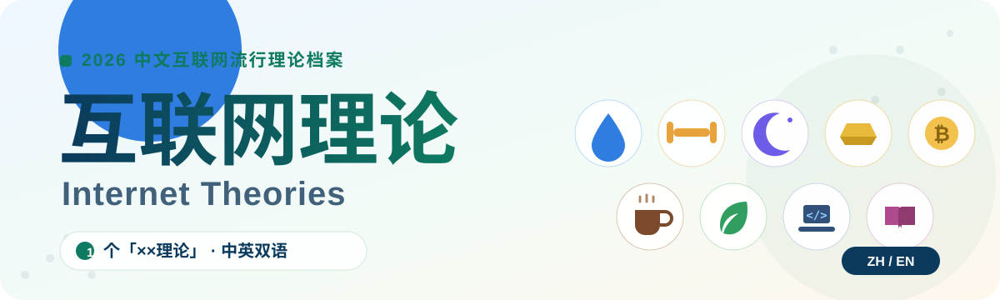

<div align="center">

# 互联网理论 · Internet Theories

### 一套来自中文互联网的 17 个「××理论」档案 · 中英双语

[](https://github.com/TA123123/internet-theories/stargazers)
[](https://github.com/TA123123/internet-theories/network/members)
[](https://github.com/TA123123/internet-theories/commits/main)
[](https://github.com/TA123123/internet-theories)
<br/>
[](#-目录)
[](#-两个语言版本)
[](#-说明与免责声明)



**[📖 中文文档 `zh/`](./zh/)** ｜ **[📖 English docs `en/`](./en/)** ｜ **[README in English](./README-EN.md)**

</div>

---

> 2026 年秋天，抖音上刮起一阵"××理论"风：一只手拎起两升装的大水瓶，配文"弱者喝饮料，强者喝大水"，随后"薄肌理论""大睡理论"接连出圈，演化成一整套年轻人的极简健康生活方式。
>
> 本仓库把这类"一个口号 + 一套生活方式"的流行理论搜集、整理成可检索的文档——**每一篇都还原它的出处、核心主张、实践方法，以及热闹之外的理性提醒。**

## 📑 目录

### 🌿 一、生活方式（极简健康三部曲）

| | 理论 | 一句话 |
|:---:|:---|:---|
| 🌊 | [大水理论](./zh/01-大水理论.md) | 少喝奶茶饮料，多喝大瓶矿泉水，健康又省钱 |
| 💪 | [薄肌理论](./zh/02-薄肌理论.md) | 不追求夸张大肌肉，练出清晰自然的肌肉线条 |
| 🌙 | [大睡理论](./zh/03-大睡理论.md) | 每天睡满 8 小时，睡眠就是生产力 |
| 🥗 | [抗炎饮食理论](./zh/09-抗炎饮食理论.md) | 减少高糖、高度加工食品，多吃天然食物 |
| 🧋 | [冰美式理论](./zh/10-冰美式理论.md) | 低价冰美式，简单、高效、提神，打工人续命神器 |
| 🏃 | [运动员体魄理论](./zh/14-运动员体魄理论.md) | 拥有力量、耐力与运动能力，更健康、更有活力 |
| 🌿 | [低成本养生理论](./zh/15-低成本养生理论.md) | 不追求昂贵保健品，用简单方式长期保持健康 |
| 🧾 | [极简消费理论](./zh/16-极简消费理论.md) | 减少不必要的消费，把钱花在真正提升生活质量的地方 |

### 💰 二、财富与资产

| | 理论 | 一句话 |
|:---:|:---|:---|
| ₿ | [比特币定投理论](./zh/06-比特币定投理论.md) | 长期定投比特币，拥抱数字资产，追求财富自由 |
| 🥇 | [实体黄金理论](./zh/07-实体黄金理论.md) | 持有实物黄金，重视资产安全，对抗不确定性 |

### 🚀 三、成长与放大器

| | 理论 | 一句话 |
|:---:|:---|:---|
| 🤖 | [GPT理论](./zh/04-GPT理论.md) | 善用 ChatGPT 等 AI 工具，提高学习、工作、生活效率 |
| ⌨️ | [Vibe Coding理论](./zh/05-Vibe%20Coding理论.md) | 利用 AI 辅助编程，普通人也能开发软件 |
| 🎓 | [雅思英语理论](./zh/08-雅思英语理论.md) | 英语流利，雅思 7 分+，提升个人竞争力 |
| ✨ | [早C晚A理论](./zh/11-早C晚A理论.md) | 早上维 C，晚上维 A 类护肤，科学护肤保持年轻 |
| 🌐 | [多语言理论](./zh/12-多语言理论.md) | 掌握英语等多种语言，扩大个人发展空间 |
| 📣 | [个人IP理论](./zh/13-个人IP理论.md) | 通过短视频、自媒体打造个人影响力，让兴趣变现 |

### 👑 四、人物思想

| | 理论 | 一句话 |
|:---:|:---|:---|
| 👑 | [孙学（孙宇晨理念）](./zh/17-孙学.md) | 孙学的本质，是赢——一套极端生存实用主义哲学 |

## 🗂 两个语言版本

```bash
互联网理论/
├── README.md          # 中文索引（本文件）
├── README-EN.md       # 英文索引
├── banner.svg         # 封面横幅
├── zh/                # 17 篇中文文档
└── en/                # 17 篇英文文档（与中文一一对应）
```

<details>
<summary><b>📐 每个文档的统一结构</b></summary>

```
一句话概括      ——它究竟是什么
走红背景        ——什么时候、为什么火
核心主张        ——支撑这个理论的逻辑
怎么做          ——可执行的实践路径
争议与提醒      ——流行叙事之外的另一面
参考来源        ——资料出处
```

</details>

<details>
<summary><b>⚠️ 说明与免责声明</b></summary>

- 内容整理自公开新闻报道、百科词条与经验分享，资料搜集时间：**2026 年 10 月 12 日**。
- 部分"理论"（如薄肌、大水）属于**网络衍生流行概念**，并非严谨的学术/专业术语，文档中已尽量区分流行说法与科学共识。
- 涉及健康与投资的篇目仅供信息参考，**不构成医疗或投资建议**；重大决策请咨询医生、持牌理财顾问等专业人士。
- 关于仓库名：GitHub 仓库名仅支持 ASCII 字符（中文会被系统清洗，如"互联网理论"→"-"），故仓库采用英文名 `internet-theories`，仓库主题即"互联网理论"。

</details>

---

<div align="center">

⭐ **如果这个仓库对你有用，欢迎点个 Star** ⭐

*Made with 🖋️ by 墨 · 2026-10-12*

</div>
